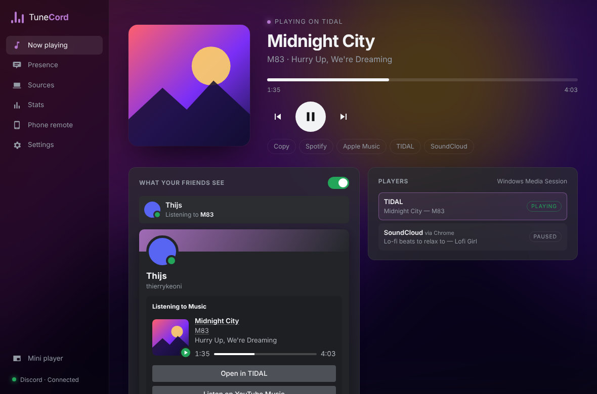

# TuneCord 🎧

Show what you're listening to as your **Discord status**: Spotify, Apple Music, TIDAL, SoundCloud, Deezer, YouTube Music, Amazon Music and more. **No need to link Spotify to Discord**, and no Discord login.

Your friends see:

> **Thijs**
> Listening to **M83**
>
> *Listening to Music*
> 🖼️ **Midnight City**
> M83 · Hurry Up, We're Dreaming
> 1:35 ━━━━━━━──── 4:03
> [ Open in TIDAL ]

Works on **Windows, macOS and Linux** (including Steam Deck desktop mode). Built on the same engine as [SteamStatus](https://github.com/ThierryKeoni/SteamStatus).



---

## Features

- 🎧 **Real "Listening to"**: the member list says *Listening to M83* (or the song, or the app name; you choose).
- 🖼️ **Album art** from the player, or looked up automatically when the player doesn't share it.
- ⏱️ **Progress bar** with elapsed and total time, so it moves on its own in Discord.
- 🔗 **Clickable song and artist**, plus up to **2 buttons** ("Open in TIDAL", "Listen on Spotify", …) that friends can click.
- ✍️ **Presence designer**: write your own lines with `{title}`, `{artist}`, `{album}`, `{player}`… Optional bits in `[ ]`. Live Discord-style preview.
- ⏸️ **Paused**: show it as paused, keep it, or hide it, and hide a paused song after X minutes.
- 🧭 **Sources**: pin a player, hide ones you don't want (e.g. Spotify if you already linked it), or rename a browser to "SoundCloud".
- 🏷️ **Different app per player** (optional): Discord can say *Listening to TIDAL* or *Listening to Apple Music*.
- 🙈 **Guilty-pleasure filter**: artists or words that never reach Discord.
- 🎛️ Music controls, global hotkeys, tray menu, mini player.
- 📱 **Phone remote**: scan a QR code and control music + your status from your phone.
- 📊 **Listening stats**: minutes today, streak, top artists and tracks. Only stored on your computer.
- 🧪 **Send test** button that puts a sample song on your profile for 30 seconds.

## Supported players

| OS | How | Players |
|---|---|---|
| **Windows 10/11** | System media session (the media card in the volume flyout) | Spotify, Apple Music, iTunes, TIDAL, Deezer, Amazon Music, YouTube Music, SoundCloud / anything in Chrome, Edge, Firefox, foobar2000, MusicBee, VLC… |
| **macOS** | AppleScript | Spotify, Apple Music. Install [`media-control`](https://github.com/ungive/media-control) (`brew install media-control`) to also get TIDAL, browsers (SoundCloud, YouTube Music) and everything else in Now Playing |
| **Linux** | MPRIS (D-Bus) | Spotify (incl. Flatpak), browsers (SoundCloud/TIDAL/YouTube Music tabs are recognised by URL), Strawberry, Elisa, Rhythmbox, Cider, … |

Discord desktop must be running (regular, Flatpak, Snap and Vesktop are supported). The Discord website can't show Rich Presence.

## Install

Download from the **[Releases](../../releases)** page. Don't use **Code → Download ZIP** or "Source code (zip)": that's the code, not the app.

- **Windows:** `TuneCord-Setup-x.y.z.exe` or `TuneCord-Portable-x.y.z.exe`. On "Windows protected your PC" click **More info → Run anyway** (the app isn't code-signed).
- **macOS:** the `.dmg`. Unsigned builds: right-click → Open.
- **Linux:** `.AppImage` (make it executable), `.deb` or `.tar.gz`.

## Setup for the developer (once, before you publish)

Discord shows Rich Presence under an "application". You make one for free, and everyone who downloads TuneCord uses it:

1. Go to <https://discord.com/developers/applications> → **New Application**. The name is what appears after "Listening to", e.g. **Music**.
2. Optional: upload an app icon on that page.
3. Copy the **Application ID** and put it in [`src/core/app-id.js`](src/core/app-id.js) (`BUILTIN_CLIENT_ID`).
4. The small play/pause icons and fallback cover are loaded from `assets/presence/` in this repo via `raw.githubusercontent.com`. If your repo isn't `ThierryKeoni/TuneCord`, change `ICON_BASE_URL` in the same file.

Without a built-in ID, users see a short "paste your Application ID" step in Settings.

**Want "Listening to TIDAL" / "Listening to Apple Music"?** Make an extra application per service, named after it, and fill in the IDs under Settings → Discord → *Different app per player*.

### Publishing a release

```bash
# bump "version" in package.json, commit, then:
git tag v1.0.0
git push origin v1.0.0
```

GitHub Actions builds Windows, macOS and Linux and creates the Release. If you build locally, upload **only** `dist/TuneCord-Setup-*.exe` and/or `dist/TuneCord-Portable-*.exe`, never `dist/win-unpacked/TuneCord.exe` on its own.

## FAQ

**I already linked Spotify to Discord. Do I appear twice?**
Yes, if both run. Either switch Spotify off under Sources, or unlink Spotify in Discord → Settings → Connections and let TuneCord show everything.

**My buttons don't show.**
Discord never shows your own buttons to you. Ask a friend, or look from a second account.

**It doesn't start / nothing shows?**
Check Settings → Activity, or the log: `%APPDATA%\TuneCord\logs\main.log` (Windows), `~/Library/Application Support/TuneCord/logs` (macOS), `~/.config/TuneCord/logs` (Linux).

## How it works

TuneCord reads "now playing" from your OS (the same source as your media keys) and sends it to the Discord desktop app over Discord's local Rich Presence socket. No account login, no tokens, no internet calls except the optional album-art lookup (iTunes Search API) and the images Discord loads itself.

- Updates are rate-limited to Discord's limit (5 per 20 s); only the newest one is sent.
- The progress bar uses start/end timestamps, so Discord animates it without extra updates. Seeking resets it.
- When Discord is closed, TuneCord waits and reconnects by itself.
- If an older Discord build rejects the newest presence fields, TuneCord retries without them automatically.

## Run from source

```bash
npm install
npm start               # the app
npm run start:headless  # no window
npm test                # engine + Discord-protocol tests (no Discord needed)
npm run dist            # build installers for your current OS
```

## Project layout

```
src/
  core/      engine, Discord IPC client, presence builder, templates, stats, phone remote
  media/     one backend per OS: Windows SMTC (PowerShell helper), macOS JXA, Linux MPRIS
  main/      Electron main process: tray, window, hotkeys, autostart
  renderer/  the UI (plain HTML/CSS/JS); mock.js lets you open it in a browser
assets/presence/  icons Discord loads from GitHub (play, pause, fallback cover)
test/        tests, including a fake Discord server
```

## Notes

Not affiliated with Discord, Spotify, Apple, TIDAL or SoundCloud. Names belong to their owners.
